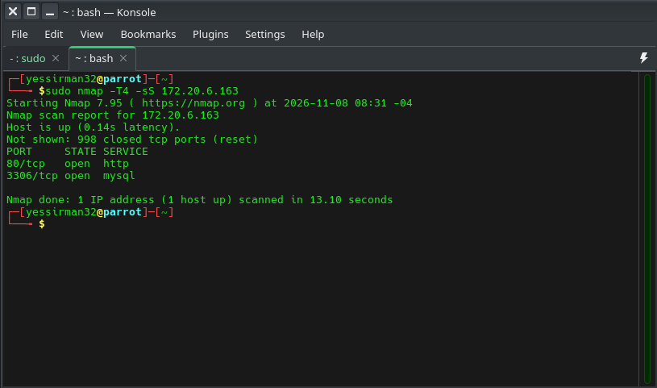
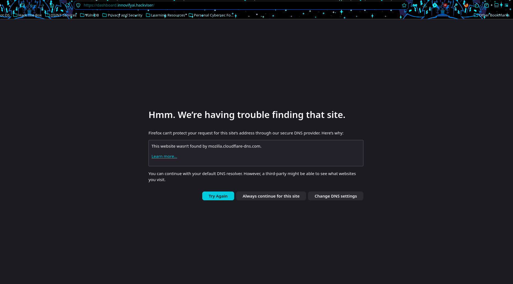
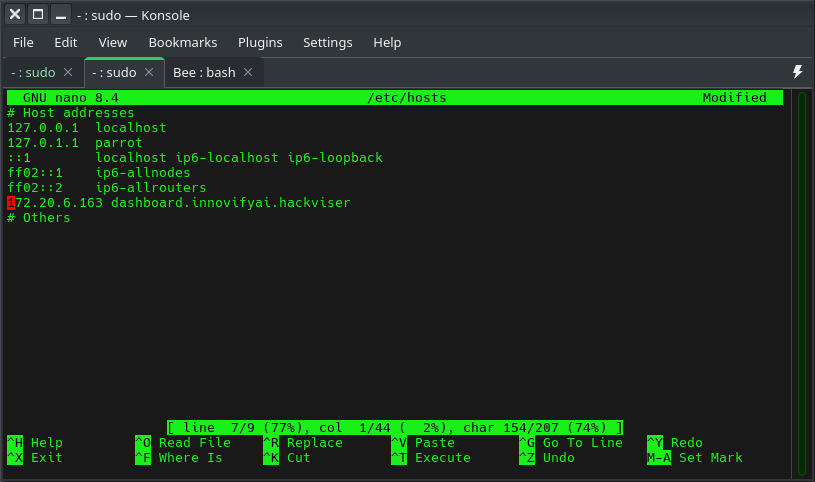
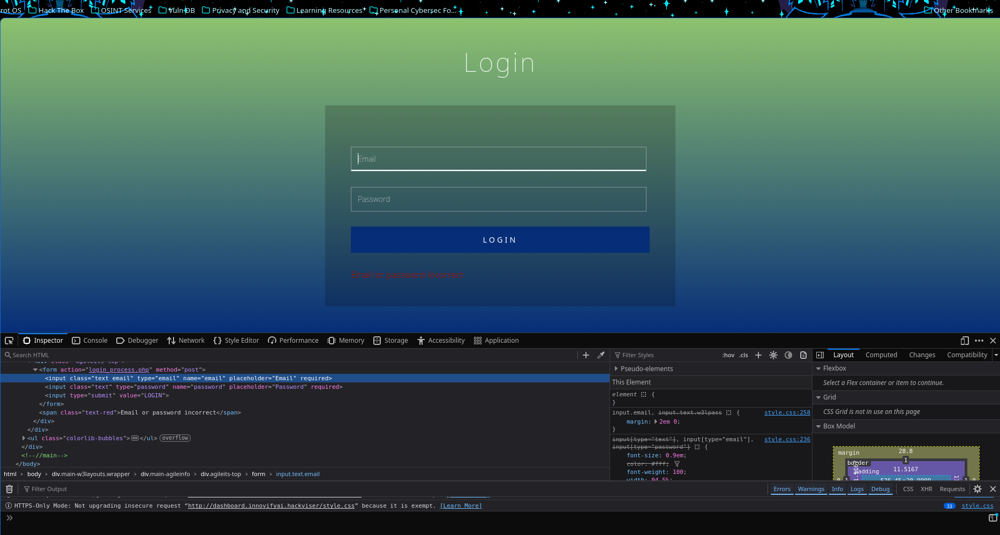
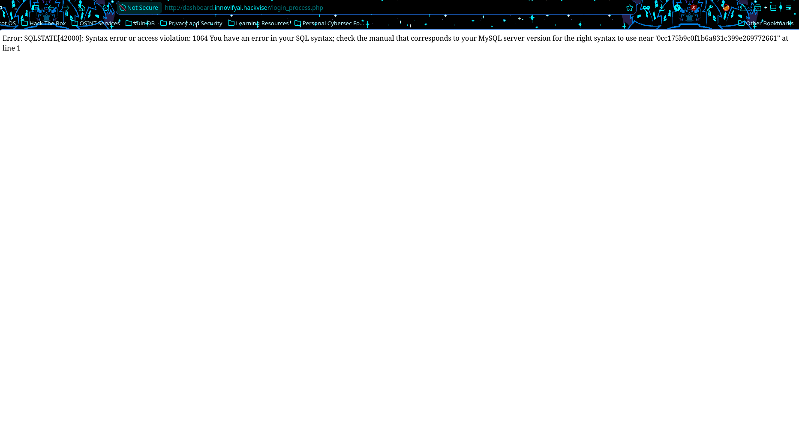
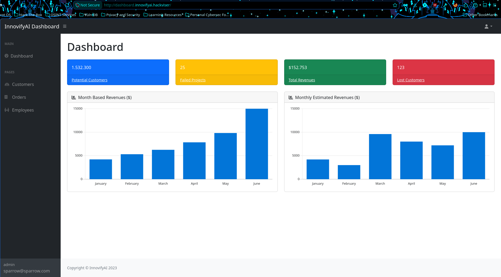
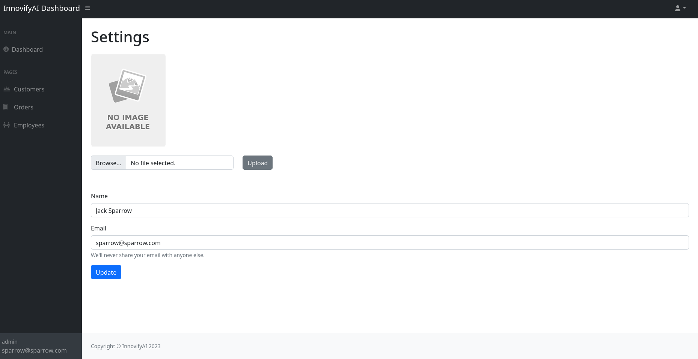
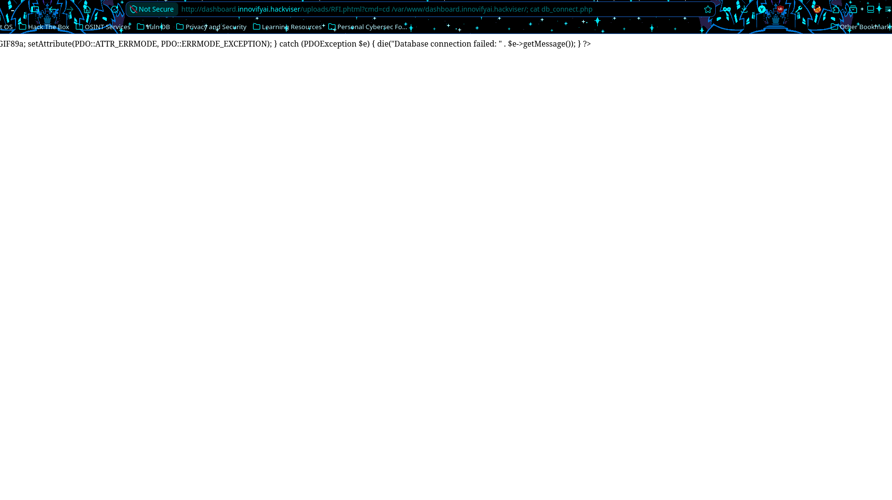
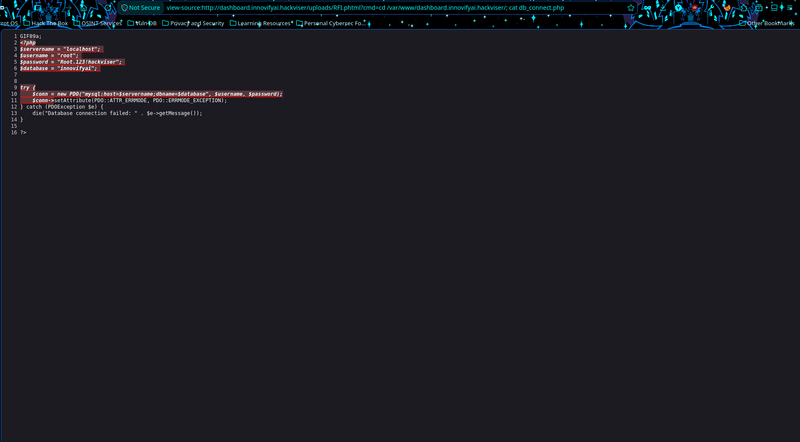

# Hackviser Bee Warmup

## Executive Summary
An SQL injection and file upload vulnerability revealed root credentials

## Introduction
SQL is a database query language which helps users create, update, maintain, and search databases. When misconfigured, it can allow bypassing logins

File uploads are common for things such as profile pictures. If they go unverified, it can lead to Remote code execution (RCE)

## Objective
Find a way to exploit the SQLi vulnerability and File upload vulnerability on the target machine 

## Scope
The scope of this engagement is the target machine. This is a white box engagement

Information given:
- IP address: 172.20.6.163
- Vulnerability types
- Writeup available

## Methodology
nmap was used for reconnaissance, a php file with the extension phtml was used to achieve RCE 

## Findings
We first used nmap to gain information on the target

We found that ports 80 (http) and 3306 (mysql) are running

We further enumerate the http service by going to the website

We see that there is a login button. We attempt to go to the login page

The request failed because it redirected to a new domain. To get around this, we put the same IP address we scanned with nmap in our /etc/hosts file

After that we retry the request

The request was successful. We are met with a login screen. We try to enumerate the password field, but it never returns an SQL Error.  

We try to do the same with the email field, but it only accepts an email address.

To get around this, we change the html attribute requiring an email address. We remove the following line of code:

type="email"

After that, we try to enumerate with SQL.

We get a proper SQL error. Trying the SQL injection, we get a successful login

Severity assessment: 🟠 **High**

To enumerate further, we go into the user settings page

There's no password shown, but there is a profile picture upload. We try uploading a preset php file with GIF89a; (The magic header for GIF files)

The upload is successful, and we achieve RCE

Severity assessment: 🔴 **Critical** 

Enumerating further shows a file named db_connect.php

We attempt to cat the file

It only shows a few lines. To get around this, we view the source of the page

Severity assessment: 🔴 **Critical**

## Remediation
- Fix the SQL injection vulnerability using input santiziation
- Fix the file upload vulnerability by validating what files are allowed to be uploaded
- Change all leaked credentials

## Conclusion
The misconfiguration of SQL led to account compromise, the missing input validation for uploading files allowed RCE, which led to compromise of root credentials. Overall risk was 🔴 **Critical** 
